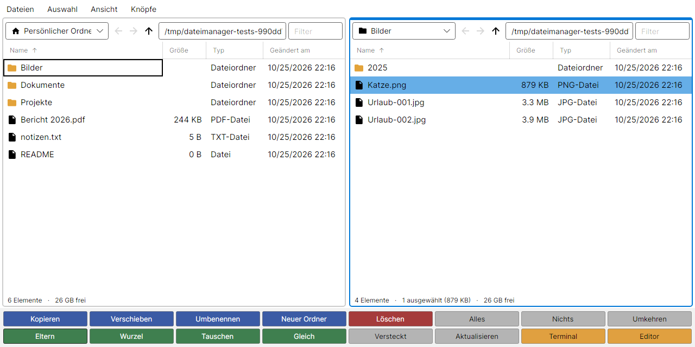
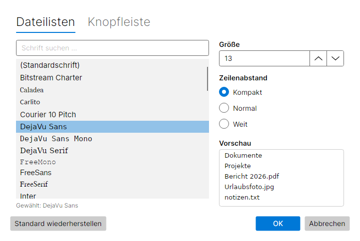
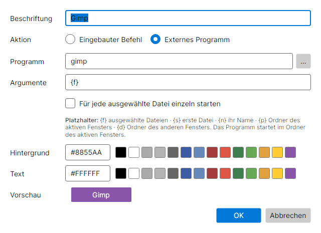

# Dateimanager

Ein plattformübergreifender Dateimanager für Windows, Linux und macOS, gebaut mit
[Avalonia UI](https://avaloniaui.net/) 12 und .NET 10. Zwei Fenster nebeneinander wie im
**Total Commander**, darunter frei belegbare, farbige und umschaltbare Knopfbänke wie bei
**Directory Opus** auf dem Amiga.



## Funktionen

- **Zwei Dateifenster:** jedes mit eigener Ortsauswahl (Benutzerordner, Bilder, Laufwerke …),
  Zurück/Vorwärts-Verlauf, Adressleiste (auch `~`), Filter und Statuszeile mit freiem Speicherplatz.
  Das aktive Fenster ist blau umrandet; **Tab** wechselt.
- **Randleisten wie in Directory Opus 4:** Ein Klick auf den schmalen Streifen links oder rechts neben
  einer Dateiliste wechselt in den übergeordneten Ordner, ein Rechtsklick ins Wurzelverzeichnis.
- **Total-Commander-Bedienung:** F5 kopiert und F6 verschiebt die Auswahl ins andere Fenster
  (Ziel lässt sich im Dialog ändern), F7 neuer Ordner, F8/Entf in den Papierkorb, F2/Umschalt+F6 umbenennen.
- **Knopfbänke:** Knöpfe mit eigener Beschriftung und eigenen Farben, die entweder einen eingebauten
  Befehl oder ein externes Programm ausführen. Mehrere Bänke mit eigenem Namen und eigener Spaltenzahl,
  umschaltbar über den Umschalter links neben den Knöpfen. Rechtsklick auf einen Knopf zum Bearbeiten,
  Duplizieren, Verschieben (auch in eine andere Bank) oder Entfernen.
- **Papierkorb:** Windows-Papierkorb, freedesktop.org-Papierkorb unter Linux, `~/.Trash` unter macOS.
- **Schriftart und Zeilenabstand:** eigene Schrift und Größe für Dateilisten und Knopfleiste,
  Zeilenabstand *Kompakt* (Standard), *Normal* oder *Weit* – Menü *Ansicht › Schriftart und Zeilenabstand …*
- Sortierung per Spaltenkopf (Ordner bleiben oben), Mehrfachauswahl, versteckte Dateien,
  automatische Aktualisierung, Kontextmenü.
- Knöpfe, zuletzt geöffnete Ordner und Einstellungen werden gespeichert.

### Schriftart und Zeilenabstand



Im Dialog lassen sich Schriftart und -größe getrennt für die **Dateilisten** und die **Knopfleiste**
wählen; die Liste der installierten Schriften ist durchsuchbar und zeigt jede Schrift in sich selbst.
Die Zeilenhöhe der Dateilisten ergibt sich aus Schriftgröße und Zeilenabstand (bei 13 pt:
Kompakt 21 px, Normal 27 px, Weit 33 px).

### Knopfbänke

Links neben den Knöpfen steht der Umschalter (wie ein Cycle-Gadget der Amiga-Workbench) mit Namen
und Nummer der aktuellen Bank:

- **Klick** oder **Strg+B** – nächste Bank, **Strg+Umschalt+B** – vorherige Bank
- **Rechtsklick** – Liste aller Bänke zur direkten Auswahl
- Menü **Knöpfe** – Bank wählen, neu anlegen, umbenennen, duplizieren, umsortieren, löschen;
  Spaltenzahl der aktuellen Bank; Standardbelegung wiederherstellen
- Die eingebauten Befehle *Nächste/Vorherige Knopfbank* lassen sich auch auf Knöpfe legen

Mitgeliefert werden die Bänke **Standard** (Dateioperationen, Auswahl, Navigation, Terminal, Editor)
und **Extras** (Zurück/Vorwärts, Öffnen, Endgültig löschen, Archivieren und Entpacken mit `tar`,
System-Explorer, Terminal). Die Knopfleiste ist immer so hoch wie die größte Bank, damit die
Dateifenster beim Umschalten nicht springen.

### Knöpfe konfigurieren



Externe Programme starten im Ordner des aktiven Fensters. In den Argumenten stehen Platzhalter zur Verfügung:

| Platzhalter | Bedeutung |
| --- | --- |
| `{f}` | alle ausgewählten Dateien (als eigenes Argument: ein Argument je Datei) |
| `{o}` | wie `{f}`, aber nur die Namen ohne Pfad (relativ zum Ordner des aktiven Fensters) |
| `{s}` | erste ausgewählte Datei |
| `{n}` | Name der ersten ausgewählten Datei (ohne Pfad) |
| `{p}` | Ordner des aktiven Fensters (Quelle) |
| `{d}` | Ordner des anderen Fensters (Ziel) |

Argumente mit Leerzeichen in doppelte Anführungszeichen setzen. Mit *Für jede ausgewählte Datei
einzeln starten* wird das Programm pro Datei einmal aufgerufen. Beispiele:

| Knopf | Programm | Argumente |
| --- | --- | --- |
| ZIP packen | `zip` | `-r "{d}/archiv.zip" {o}` |
| Bild bearbeiten | `gimp` | `{f}` |
| Vergleichen | `meld` | `{s} "{d}/{n}"` |
| Shell-Befehl | `sh` | `-c "du -sh {f} \| sort -h"` |

Die Einstellungen liegen als JSON-Datei unter `%APPDATA%\Dateimanager\settings.json` (Windows)
bzw. `~/.config/Dateimanager/settings.json` (Linux/macOS) und können auch von Hand bearbeitet werden.

### Tastenkürzel

| Taste | Aktion |
| --- | --- |
| Tab | Anderes Fenster aktivieren |
| Enter / Doppelklick | Öffnen |
| Rücktaste, Alt+Hoch, Klick auf Randleiste | Übergeordneter Ordner |
| Rechtsklick auf Randleiste | Wurzelverzeichnis |
| Alt+Links / Alt+Rechts | Zurück / Vorwärts |
| F2, Umschalt+F6 | Umbenennen |
| F5 / F6 | Kopieren / Verschieben ins andere Fenster |
| F7 | Neuer Ordner |
| F8, Entf / Umschalt+Entf | In den Papierkorb / endgültig löschen |
| Strg+A | Alles auswählen |
| Strg+C / Strg+X / Strg+V | Kopieren / Ausschneiden / Einfügen (innerhalb der App) |
| Strg+U | Fenster tauschen |
| Strg+B / Strg+Umschalt+B | Nächste / vorherige Knopfbank |
| Strg+R | Beide Fenster aktualisieren |
| Strg+H | Versteckte Dateien ein-/ausblenden |
| Strg+L / Strg+F | Adressleiste / Filter des aktiven Fensters |

## Bauen und starten

Voraussetzung: [.NET 10 SDK](https://dotnet.microsoft.com/download).

```bash
dotnet run --project src/Dateimanager                       # zuletzt geöffnete Ordner
dotnet run --project src/Dateimanager -- /links /rechts     # bestimmte Ordner öffnen
dotnet test                                                 # Unit- und Headless-UI-Tests
```

Eigenständige Anwendung veröffentlichen, z. B. für Windows:

```bash
dotnet publish src/Dateimanager -c Release -r win-x64 --self-contained
```

## Aufbau

```
src/Dateimanager.Core/   Logik ohne UI-Abhängigkeit
  FileSystemService.cs     Auflisten, Anlegen, Umbenennen, Kopieren, Verschieben, Löschen
  TrashService.cs          Papierkorb je Betriebssystem
  ButtonDefinition.cs      Knöpfe, Knopfbänke, eingebaute Befehle, Standardbelegung
  CommandTemplate.cs       Platzhalter in Argumenten auflösen
  AppSettings.cs           Einstellungen als JSON laden/speichern
src/Dateimanager/        Avalonia-Oberfläche (MVVM mit CommunityToolkit.Mvvm)
  ViewModels/              MainWindow (zwei Fenster + Befehle), Pane (ein Dateifenster),
                           ButtonBar (Knopfbänke und Knöpfe), ButtonEditor
  Views/                   MainWindow, PaneView, ButtonEditorWindow
  Services/                Dialoge, Öffnen/Starten von Programmen
tests/Dateimanager.Tests/ xUnit-Tests inkl. Avalonia.Headless für ViewModels und Fenster
```

## Ideen für die nächsten Schritte

- Knöpfe per Drag & Drop anordnen
- Interne Befehle für Archive (ZIP packen/entpacken) und Dateivergleich
- Drag & Drop zwischen den Fenstern und mit dem System
- Fortschrittsanzeige und Abbrechen bei großen Kopiervorgängen
- Tabs je Fenster, Dateibetrachter (F3)
